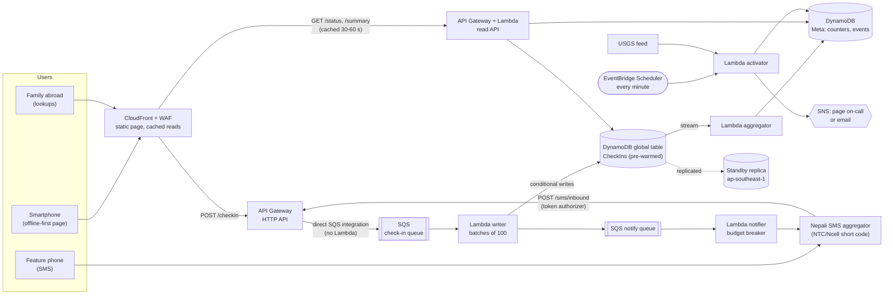
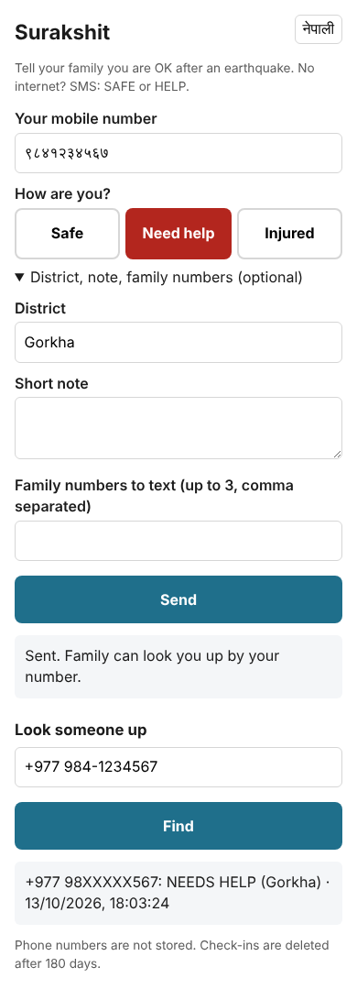
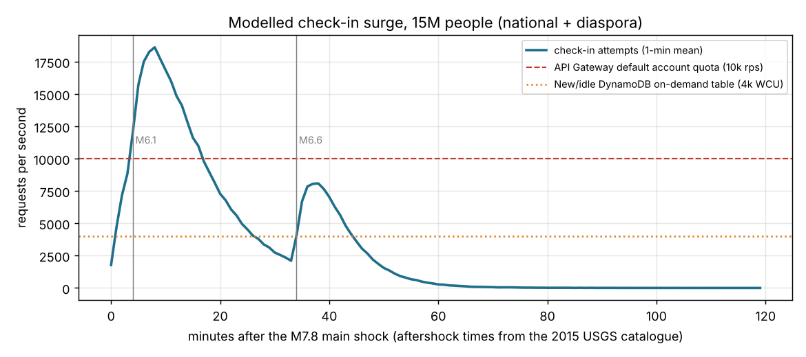
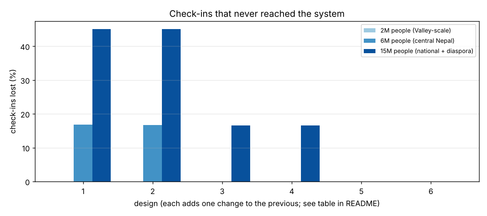

# Surakshit (सुरक्षित): "I'm safe" check-ins for the next big earthquake in Nepal

Surakshit lets people in Nepal tell their family they are safe, need help or are injured in the hours after an earthquake, from a 12 KB web page or a plain SMS, and lets anyone look a number up. It opens itself when USGS reports a quake people in Nepal will have felt, sits idle the rest of the time for **about $12 a month**, and is designed for the one thing that matters: **not losing a check-in when millions of people try in the same ten minutes.**

```text
SMS from a feature phone (+977 9851000002):   SAHAYOG sindhupalchowk ghar bhatkiyo 9841000001
Reply to the sender:                          दर्ता भयो: तपाईंलाई सहयोग चाहिएको। परिवारले KHOJ <तपाईंको नम्बर> पठाएर हेर्न सक्छन्।
SMS to the family number in the message:      सुरक्षित: +977 98XXXXX002 (Sindhupalchok) लाई सहयोग चाहिएको छ। 25 Apr 12:18 "ghar bhatkiyo"

Someone in Doha, on the web page:             GET /status?phone=9851000002
{"phone": "+977 98XXXXX002", "found": true, "status": "need_help", "district": "Sindhupalchok",
 "received_at": 1429943605950, "event_id": "2015-04-25T0611Z-us20002926", "channel": "sms"}
```
*(Real output of the writer and read API for that SMS, replayed as if it arrived 22 minutes after the 2015 Gorkha earthquake. "Sahayog" means help; "ghar bhatkiyo" means the house collapsed.)*

## The problem

At 11:56 on Saturday 25 April 2015 a magnitude 7.8 earthquake struck Gorkha. It killed almost 9,000 people and left about 3.5 million homeless. Then, for most families, came the second thing: *is everyone alright?* Phone networks were jammed, and the shaking kept coming: a M6.1 four minutes later, a M6.6 half an hour later, a M6.7 the next day, a M7.3 on 12 May.

Facebook's Safety Check worked for those who had Facebook and data: Facebook said "millions of people" were marked safe. But a Facebook check-in doesn't reach a grandmother with a feature phone, or a relief worker who needs to know how many people in Sindhupalchok asked for help, and it belongs to a company, not to Nepal.

Nepal will have another large earthquake; the question is when. A check-in service for that day has an unusual shape, and that shape is what makes it a good architecture problem:

| Property | Value | Consequence |
|---|---|---|
| Normal traffic | Zero, for years | Anything that costs money while idle is waste. |
| Event traffic | Millions of people within minutes, peaking ~8 minutes after the shock, again after each big aftershock | Must absorb a 0 to 20,000 requests/s step with no warning and no warm-up. |
| Most important property | A check-in that is accepted is never lost | Accept first, process later. |
| Users | Smartphones on congested 2G/3G, feature phones on SMS, family abroad on the web | A tiny page, an SMS door, and a read path served from a CDN. |
| Who starts it | Nobody: it's 11:56 on a Saturday and everyone is under a table | It must turn itself on. |
| Data | Where every phone number in Nepal was on the worst day of their life | Store as little as possible, and for as short as possible. |

## Architecture



Three ideas carry the design:

1. **Storage-first.** `POST /checkin` goes from API Gateway straight into SQS. There is no Lambda between a person and "202 Accepted", so the busiest minutes never depend on cold starts, Lambda concurrency or DynamoDB capacity. The writer drains the queue as fast as the table allows; if the table pushes back, the queue gets longer and nothing is lost.
2. **The client is part of the architecture.** The web page saves the check-in on the phone first and keeps retrying, with exponential backoff and full jitter, until it gets a 202. A person can close the page on a dead network and it sends next time.
3. **Serverless because the normal state is zero.** Every component scales to zero, so the yearly cost of being ready is about $140; a server fleet sized for the same peak, in two regions, is about $30,000 a year.

Full diagram, data model, scaling and disaster recovery: **[docs/ARCHITECTURE.md](docs/ARCHITECTURE.md)**.



**The page** is one 12 KB HTML file with no fonts or frameworks, in Nepali by default with an English toggle. It accepts numbers typed in Devanagari digits, saves the check-in on the phone before sending, and shows "Network busy, retrying..." instead of an error. The screenshot is a headless-browser run against `make serve`: a Devanagari number, "Need help" in Gorkha, then a lookup of the same number typed as `+977 984-1234567`.
<br clear="right">

## Results

### 1. Surge simulation: which design loses check-ins?

You can't load-test an earthquake, so I built an [agent-based simulation](surakshit/simulate.py) of the three hours after a M7.8, with each AWS service reduced to the documented limit that binds first (API Gateway's 10,000 requests/s account quota, a new on-demand DynamoDB table's 4,000 writes/s, Lambda's SQS scaling rate), and arrivals timed from the real 2015 aftershock sequence. Each design adds one change to the one before it. Sizes are scenarios, not forecasts ([why](docs/SURGE_MODEL.md)).



| Design | 2M people | 6M people | 15M people |
|---|---:|---:|---:|
| 1. Synchronous (API → Lambda → DynamoDB), clients retry immediately | 0% lost | **16.8% lost** | **45.1% lost** |
| 2. + clients back off with jitter | 0% lost | 16.6% lost | 45.0% lost |
| 3. + storage-first queue (table not pre-warmed) | 0% lost | 0% lost, p99 visible after **407 s** | 16.6% lost |
| 4. + table pre-warmed to 20k writes/s | 0% lost | 0% lost, p99 8 s | 16.6% lost |
| 5. + offline-first page: keeps retrying for hours | 0% lost | 0% lost, p99 8 s | 0% lost, p99 **1,358 s** |
| 6. + API Gateway quota raised to 30k req/s (**Surakshit**) | 0% lost | 0% lost, p99 8 s | **0% lost, p99 10 s** |

"Lost" means the person gave up (or the page did) before the system ever accepted it. "p99 visible" is the time from first tap until the check-in can be looked up, for check-ins that made it.



### What I'd tell an interviewer about these numbers

- **At the size of the Kathmandu Valley, every design works.** My first run used 2 million people and nothing broke. The design only matters past the limits, and the first limits you hit are *soft account quotas* (API Gateway 10k req/s) and *a cold table's ramp rate* (4k writes/s), not anything fundamental. Both are fixable before the event, which is why "request quota increases" and "pre-warm the table" are in the [readiness checklist](docs/RUNBOOK.md), not in the code.
- **Backoff alone didn't save a single check-in** (row 2 vs row 1). It spreads the load, but a client that gives up after six tries still gives up. What saved check-ins was not needing the table to say yes (the queue, row 3) and a client that doesn't give up (row 5).
- **The queue converts lost check-ins into late check-ins.** In row 3 at 6M nobody is lost, but the slowest 1% become visible ~7 minutes later. Pre-warming the table turns that into 8 seconds. That trade (durability now, freshness a bit later) is the whole design.
- **It's a model.** It doesn't include Nepal's own mobile network, which was the real bottleneck in 2015. That's the job of the offline-first page and the SMS door, and the reason I don't claim more than the table says.

### 2. Auto-activation, backtested on every M5+ quake near Nepal since 2015

The activator opens an event when a quake is close enough, shallow enough and strong enough to have been felt by many people in Nepal, and pages a human for M5.5+. I ran the rule over all **88** M5+ quakes USGS recorded in and around Nepal from January 2015 to September 2026 ([data](data/README.md), [details](docs/ACTIVATION.md)):

| | Count |
|---|---:|
| Quakes M5+ in the region | 88 |
| Ignored (too far, mostly southern Tibet) | 30 |
| Joined an already open event (aftershocks) | 31 |
| **Events opened** | **27** (about 2 a year; 21 of them email-only) |
| Paged on-call (M5.5+) | 6 |

**Every damaging quake in the period opens a paging event**: Gorkha 2015 (M7.8), Dolakha 2015 (M7.3), Doti 2022 (M5.7), Bajhang 2023 (M5.7), Jajarkot 2023 (M5.7, 153 deaths) and southern Tibet 2025 (M7.1, strongly felt in Kathmandu). The 25 April to 31 May 2015 sequence, with 33 M5+ shocks, opens **2** events, not 33. My first threshold for paging was M6.0, which would only have *emailed* for Jajarkot ([bug #2](docs/CHALLENGES_AND_BUGS.md#2-m60-would-only-have-emailed-for-jajarkot)).

### 3. Cost

| | USD |
|---|---:|
| **Idle month** (both regions, WAF, alarms) | **11.93 / month** |
| A 15-million-person event: platform (CloudFront, API, SQS, Lambda, DynamoDB with replication) | ~325 |
| Same event: SMS through a Nepali aggregator, with the budget breaker | ~30,500 |
| Same event: SMS through an international gateway, no breaker | ~705,000 |
| Always-on alternative (EC2 + ALB + RDS sized for the peak, two regions) | ~2,500 / month |

**SMS is 99% of the cost of an event.** That's why replies to feature-phone users always go out but family notifications stop at a per-event budget, why the free web lookup is the primary channel, and why SMS goes through a local aggregator. Itemised in [docs/COST.md](docs/COST.md).

## Engineering documents

| Document | What's in it |
|---|---|
| [Architecture](docs/ARCHITECTURE.md) | Diagram, request flows, data model, how it scales, multi-region DR (RTO/RPO), going live |
| [Alternatives considered](docs/ALTERNATIVES.md) | 10 decision records, from "why this problem" to "why not Kinesis, Aurora, ECS, AppSync, Facebook" |
| [What breaks](docs/FAILURE_MODES.md) | 20 failure modes with detection and response, including a region failure in the middle of a surge |
| [Surge model](docs/SURGE_MODEL.md) | Every assumption in the simulation, its source, and what would change the answer |
| [Activation](docs/ACTIVATION.md) | The rule, the full backtest, and its known misses |
| [Cost](docs/COST.md) | Idle and event cost, itemised, with 12 cost decisions in the code |
| [Security and privacy](docs/SECURITY_AND_PRIVACY.md) | Threat model: spoofed check-ins, number enumeration, PII in logs, SMS spam |
| [Runbook](docs/RUNBOOK.md) | Readiness checklist, what to do when the pager goes, how to promote the standby region |
| [Challenges and bugs](docs/CHALLENGES_AND_BUGS.md) | 15 real problems hit while building this, with the evidence and the fix |

## How it maps to the AWS Well-Architected pillars

| Pillar | In this project |
|---|---|
| Operational excellence | Two-region IaC (SAM); turns itself on from the USGS feed; alarms on *backlog age* and on a scheduler that silently stops, not just on errors; a runbook with a readiness checklist |
| Security | Phone numbers never stored (HMAC with a pepper in SSM); no phone numbers in any log; token authorizer on the SMS webhook; WAF tuned for carrier-grade NAT; least-privilege IAM per function; everything encrypted at rest |
| Reliability | Storage-first queue; idempotent, order-safe conditional writes; partial batch failures and DLQs everywhere; global table with a warm standby region; CloudFront fails reads over to the standby |
| Performance efficiency | No compute in the write path's accept step; pre-warmed table; 100-message batches; reads served from the CDN for 30-60 s; counters folded per batch so one busy district can't make a hot key |
| Cost optimisation | ~$12/month idle; SMS budget breaker; reply in one language (Nepali SMS cost 2-3x more segments); metrics emitted only when non-zero; Graviton Lambdas |
| Sustainability | Nothing runs while nothing is happening, which is almost always |

## Run it

**With Python 3.12+:**

```bash
make setup && source .venv/bin/activate
make demo        # replay the first hours of 25 April 2015 through the real writer, aggregator and SMS parser
make backtest    # activation rule over 88 real quakes since 2015 (artifacts/reports/activation_backtest.json)
make simulate    # the surge table and charts above (~90 s)
make cost        # idle and event cost model
make serve       # web page + API on http://localhost:8000 (try /docs)
make test        # 63 tests, including every Lambda handler against mocked AWS (moto)
```

**On AWS:** [infra/README.md](infra/README.md): a WAF stack in us-east-1, the primary in ap-south-1 (Mumbai, the closest region to Nepal), and a standby in ap-southeast-1 (Singapore). I haven't left it deployed: an idle stack is cheap, but SMS isn't, and a public check-in page for an event that hasn't happened shouldn't exist outside a drill.

## Repository layout

```text
surakshit/
  phone.py        Nepali numbers as people type them (Devanagari digits, +977, trunk 0) -> one keyed hash
  checkin.py      check-in validation; SMS parser for English, romanised Nepali and Devanagari
  writer.py       queue -> table: idempotent, order-safe, poison-tolerant; builds the SMS outbox
  aggregate.py    stream -> per-district counters, folded per batch
  activation.py   USGS feed -> events: felt-radius rule, aftershock grouping
  store.py        LocalStore and DynamoStore behind one interface (conditional UpdateItem)
  messages.py     outbound SMS in one language, never both
  sms_gateway.py  dry run / Nepali aggregator / AWS End User Messaging, and the budget breaker
  reads.py        what a lookup is allowed to reveal
  simulate.py     agent-based surge simulation of six designs
  aws/            Lambda handlers and the SMS webhook authorizer
web/index.html    the 12 KB offline-first page, Nepali and English
infra/            SAM template (two regions), WAF template, deploy guide
data/             USGS catalogue of M5+ quakes near Nepal, 2015-2026
tests/            63 tests: phone parsing, SMS, writer semantics, activation, handlers on moto, simulator
docs/             the engineering documents above
```

## Data and credits

Earthquake catalogue: U.S. Geological Survey, ANSS Comprehensive Catalog, via the [FDSN event web service](https://earthquake.usgs.gov/fdsnws/event/1/) ([data/README.md](data/README.md)). Live activation uses the USGS GeoJSON summary feed. Casualty figures are from the USGS event pages and contemporary reporting. AWS service limits are from the AWS documentation pages linked in [docs/SURGE_MODEL.md](docs/SURGE_MODEL.md).

## License

MIT.
