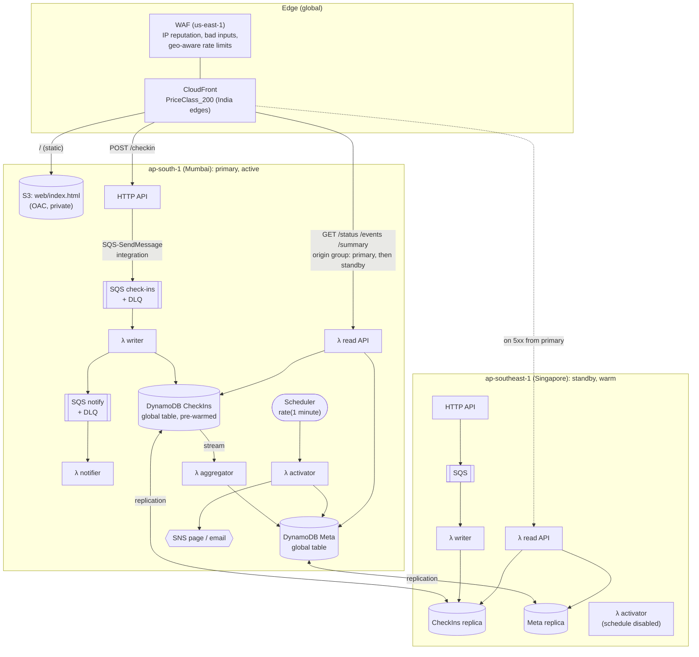

# Architecture

## The question I designed around

*At 12:05 on the day of the next big earthquake, six million people in Nepal open their phones at once. What has to be true for every one of them who presses "Send" to be findable by their family, and what does that cost on the other 364 days of the year?*

Two requirements fall out of that and drive nearly every choice:

1. **Accepting a check-in must not depend on anything that can run out.** Not Lambda concurrency, not table capacity, not a database connection pool.
2. **Being ready must cost close to nothing.** The service is idle for years at a time. A design that needs servers sized for the peak is paying for a disaster every hour of every day.

## Deployment

Everything above is in [infra/template.yaml](../infra/template.yaml) (one template, deployed twice with `Role=primary` and `Role=standby`) and [infra/waf.yaml](../infra/waf.yaml).

### Why each piece exists

| Component | Why | What I'd lose without it |
|---|---|---|
| CloudFront | Serves the 12 KB page and caches lookups for 30-60 s at Indian edge locations, a few hundred km from Nepal. Fails read requests over to Singapore. | Every family refreshing a lookup hits Lambda and DynamoDB; reads die with the region. |
| WAF | Blocks known-bad IPs and scripted lookups from abroad. Loose inside Nepal on purpose (carrier-grade NAT, see below). | Number enumeration and junk traffic in the busiest hour. |
| HTTP API → SQS (no Lambda) | The accept step is a managed integration with no compute. 202 means "durably queued in three AZs". | A cold start or a full concurrency pool turns into a lost check-in (rows 1-2 of the README table). |
| SQS check-in queue | The shock absorber. Holds 14 days of check-ins if it has to. | Writes have to succeed at the moment of arrival. |
| Writer Lambda | Batches of 100; conditional writes that make duplicates and reordering harmless; reports partial failures so only throttled messages are retried. | |
| DynamoDB global table, pre-warmed | One partition key per phone number, so load spreads evenly; on-demand so it costs nothing idle; pre-warmed to 20k writes/s so it doesn't need 30 minutes to ramp; replicated to the standby. | The 4,000 writes/s ramp limit binds at 6M people (row 3: p99 of 7 minutes). |
| Stream → aggregator | Per-district counts for responders, without the writer knowing counters exist. Folded per batch. | Either no summary, or a hot partition key on "Kathmandu#safe" (see "Scaling"). |
| Notify queue → notifier | Decouples SMS (slow, rate-limited by the provider, expensive) from writing. MaximumConcurrency keeps us under the provider's TPS; the budget breaker keeps us under the money. | A slow SMS provider would back up the check-in writer. |
| Scheduler → activator | Opens events from the USGS feed without a human. Reserved concurrency 1 so two runs can't race. | Someone has to log in to AWS during an earthquake. |
| Standby region | A warm copy that can take over reads instantly (CloudFront) and writes by promotion. Costs ~$1/month idle. | An AWS region incident on the worst possible day takes the service down. |

## Request flows

**Web check-in.** The page saves the check-in to `localStorage`, then `POST /checkin`. API Gateway's SQS integration stamps three message attributes (`source=web`, `requestId`, `requestTimeEpoch`) and returns 202. The page deletes its local copy only after the 202, and otherwise retries with backoff and full jitter, capped at 5 minutes, for as long as it is open, and again on the next visit. The writer picks the message up within about a second (batching window), resolves which event it belongs to, hashes the number and writes.

**SMS check-in.** A person texts the aggregator's short code. The aggregator calls `POST /sms/inbound` with a shared token header; a Lambda authorizer checks it (cached 5 minutes, so it runs a few times per event, not per SMS); the same SQS integration queues it with `source=sms`. The writer parses keywords in English, romanised Nepali and Devanagari, writes the check-in, and queues a reply in the language the person used.

**Lookup.** `GET /status?phone=...` goes to CloudFront. A cache hit is served from the edge; a miss goes to the read Lambda, which normalises the number, hashes it and does one Query (`pk = hash`, newest first, limit 1). The response carries `Cache-Control: max-age=30`. It reveals status, district, time and the quake, never the note.

**Activation.** Every minute the activator reads the USGS "M4.5+ past hour" GeoJSON feed. For each quake it decides (magnitude, depth, distance to the nearest of 17 Nepali population centres against a magnitude-dependent felt radius), groups aftershocks into the open event, and creates new events with a conditional put. M5.5+ pages on-call; smaller events email. Full rule and backtest: [ACTIVATION.md](ACTIVATION.md).

## Data model

| Table | pk | sk | Attributes | Access pattern |
|---|---|---|---|---|
| CheckIns | `HMAC(phone)` (32 hex chars) | event id, e.g. `2015-04-25T0611Z-us20002926` | status, district, note, received_at, checkin_id, channel, updates, expires_at (TTL) | Write: conditional UpdateItem. Read: Query newest-first, Limit 1. |
| Meta | `EVENT` | event id | magnitude, place, severity, usgs_ids, started_at | List recent events (newest first). |
| Meta | `COUNT#<event id>` | `<district>#<status>#<shard 0-9>` | n | Summary: one Query per event, summed per district. |
| Meta | `SMS` | event id | n | Budget breaker: one ADD per notifier batch. |

Decisions in that table:

- **Event ids start with the UTC time** so that sorting by sort key sorts by time, and "this person's latest check-in, whichever event" is a single Query.
- **No phone numbers anywhere.** The partition key is an HMAC with a pepper from SSM Parameter Store. A plain SHA-256 would be reversible: there are only 300 million possible Nepali mobile numbers. Contacts to notify exist only inside the queue message and the outbound SMS.
- **The writer's condition does three jobs in one round trip:** `attribute_not_exists(pk) OR (received_at < :new AND updates < :max)`. New person: write. Newer message: write. Older message arriving late, a redelivery, or the 21st update from one number: rejected, and `ReturnValuesOnConditionCheckFailure` tells the writer which of those it was without a second read.
- **The server's clock decides order, never the phone's.** A phone that has been flat for a day often boots with the wrong date.
- **Items expire after 180 days** through TTL. The aggregator ignores TTL deletions (they come from the `dynamodb.amazonaws.com` principal), so old events' counts don't drift down.

## How it scales

| Load | What happens | Limit that binds next |
|---|---|---|
| Idle (years) | Activator runs once a minute; Lambda pollers long-poll empty queues | Nothing |
| 2M people, ~2,800 req/s peak | Nothing interesting. Queue depth stays under 20k for under a minute. | |
| 6M, ~8,400 req/s | Queue absorbs the first minute while Lambda adds pollers (300 more per minute). p99 time-to-visible 8 s. | A cold table: 4,000 writes/s (pre-warmed away) |
| 15M, ~21,000 req/s | Above API Gateway's default 10,000 req/s account quota. With the quota raised to 30k (a support request, done in advance), p99 10 s. | Account DynamoDB table quota (40,000 writes/s by default), then Lambda account concurrency (1,000 by default; writer needs ~150 at this load) |
| One district sends 35% of check-ins | Counter updates are folded per batch (one write per district and status per batch of 100), and counter keys are sharded 10 ways. | At 15M the writer commits ~210 batches/s, so the busiest counter (Kathmandu, safe) gets ~210 writes/s before sharding and ~21 per shard key, far under the 1,000/s per-key limit. One write per check-in would have been ~7,000/s on that key. |
| Lookups: 4 per check-in | CloudFront serves ~60% (assumed); the rest are a Lambda and a half-unit DynamoDB read. | API Gateway quota is shared by reads and writes: the read cache is what keeps reads from eating the write budget. |

The numbers come from [the surge model](SURGE_MODEL.md); the counter arithmetic assumes Kathmandu district sends 35% of check-ins.

**Carrier-grade NAT changes the security design.** NTC and Ncell put mobile subscribers behind shared public IPs. A typical "100 requests per 5 minutes per IP" rule would block a whole town. Rate limits are therefore strict outside Nepal (where scripted lookups come from) and only stop the absurd inside it.

## Disaster recovery

The disaster this system exists for happens in Nepal; the AWS region is in Mumbai, about 1,500 km from Kathmandu and far from the Himalayan front. A Nepal quake is very unlikely to affect the region. The DR plan is for the *coincidence* of an AWS regional problem and an event, which is rare but which would be catastrophic for the people relying on the service in that hour.

| Strategy | RTO | RPO | Idle cost | Verdict |
|---|---|---|---|---|
| Backup and restore (PITR, redeploy elsewhere) | Hours | Minutes | ~$0 | Too slow: the event is over before you're back. |
| Pilot light (tables replicated, no compute) | 30-60 min (deploy compute, switch DNS) | Seconds | ~$0.50 | Deploying CloudFormation during an incident is the wrong time to find a broken template. |
| **Warm standby (chosen)** | **Reads: seconds (CloudFront origin failover). Writes: ~5 min (promote runbook).** | **Seconds for written check-ins; queued-but-unwritten check-ins wait for the region (see below)** | **~$1/month** | Serverless makes the standby nearly free while idle, so the usual cost argument against it doesn't apply. |
| Active-active (both regions accept writes) | ~0 | ~0 | ~$1/month | Same cost, but two regions writing the same person's item resolve conflicts by last-writer-wins on *replication* time, which can undo my "newer server timestamp wins" rule. Not worth it for a ~5 minute RTO gain. |

**RPO in detail.** Once a check-in is written it's in both regions within about a second (global table replication). The gap is check-ins that were *accepted* (202) but not yet *written* when the region failed: they sit in the Mumbai SQS queue, durable but unreachable until it recovers. In the 15M scenario the queue peaks at about 176,000 messages for a few seconds. Those people were told "sent" and their families will see "no check-in yet" until Mumbai is back. Closing that gap would need the page to keep its local copy until a lookup confirms the write, doubling read traffic; I've listed it as a known gap rather than pretending it's zero ([FAILURE_MODES.md](FAILURE_MODES.md)).

**Why writes don't fail over automatically.** CloudFront origin groups only fail over GET, HEAD and OPTIONS. Automatic write failover would need Route 53 failover records on a custom API domain and health checks, plus moving the "active" role (activator, aggregator) automatically, and an automatic flip of the active role is how you get two regions both counting. With a 5-minute manual promotion and an on-call page already firing, I chose the runbook.

## Local mode

`make serve` runs the same writer, aggregator and read logic in one process (`surakshit/local.py`): an in-memory queue, an in-memory store with the same conditional-write semantics as DynamoDB, and an SMS outbox. The Lambda handlers are tested against moto, so the AWS-specific code paths (message attributes, stream images, low-level condition-failure items) are tested too.

## Going live

What would have to happen before this served a real event:

1. **An SMS short code.** The inbound channel needs a short code with NTC and Ncell, which in practice means a contract with a local aggregator (Sparrow SMS, Aakash SMS and others offer two-way SMS) and probably a partner organisation with standing in Nepal: the Nepal Red Cross Society, or the National Disaster Risk Reduction and Management Authority (NDRRMA).
2. **Quota increases, filed in advance:** API Gateway account throttle to 30,000 req/s in ap-south-1 and ap-southeast-1; Lambda concurrency headroom. These are support requests that take days, not minutes.
3. **A drill twice a year** (`scripts/open_event.py`), including promoting the standby.
4. **A data protection review.** Nepal's Individual Privacy Act, 2075 (2018) applies to this data; the retention period and what a lookup reveals should be agreed with the partner, not set by me.
5. **A custom domain** that people can remember and that operators can repoint.
